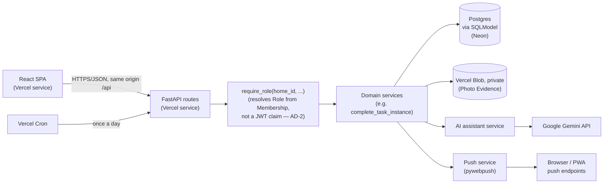
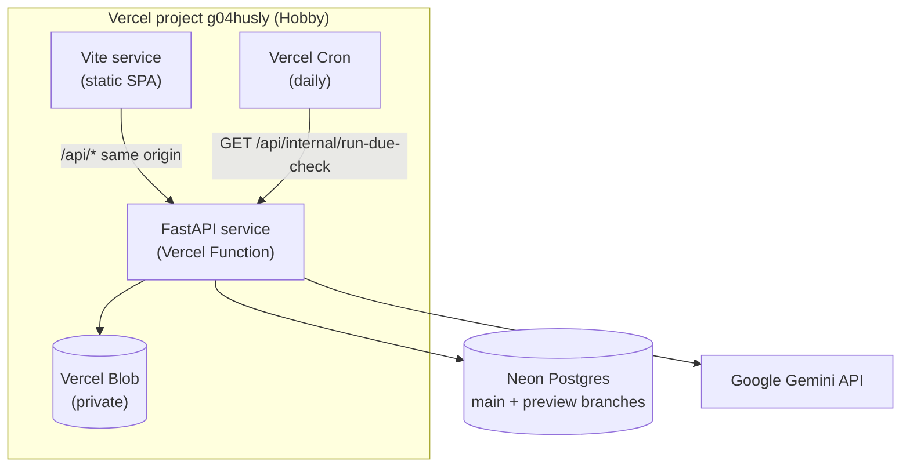
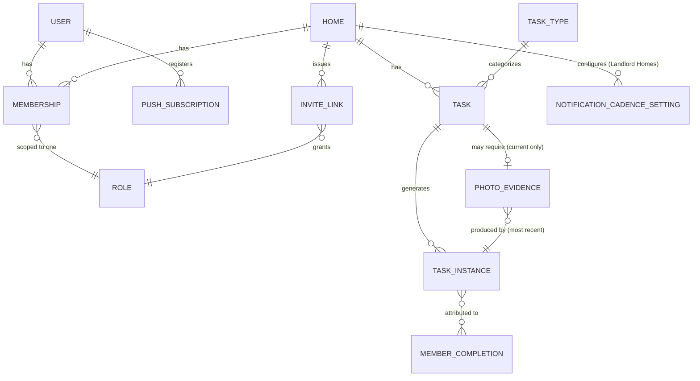

# Architecture Spine — Husly

> **Revision 2026-10-11:** Updated in response to the teacher's feedback of 2026-10-06 (see `sprint-change-proposal-2026-10-11.md`): new AD-15 makes local Docker-based running the primary path (FR-22); AD-4 gets a provider interface with a mock implementation; the single shared Supabase development database is replaced by one local database per developer; hosting becomes an optional demo setup; decisions that only apply to Trinn 2 are tagged with a **Stage**; AD-13's primary colour is corrected to match DESIGN.md (`#6E62CC`).

> **Revision 2026-10-25 (Story 1.1 scaffold):** Stack versions pinned at setup. FastAPI: "latest 0.14x" was a snapshot of the newest line at authoring, not an intended cap, so the team chose the newest release, 0.162.0. TypeScript: pinned to 6.0.3 rather than the newest 7.0, because `typescript-eslint` 8.72 (the linter) supports only TypeScript below 6.1.

> **Revision 2026-11-01 (Vercel as the only hosting):** The course now supports Vercel as its only hosting (see `sprint-change-proposal-2026-11-01.md`). The optional hosted demo moves to one Vercel project with the frontend and FastAPI as Vercel Services on one domain, Neon Postgres (a branch per preview) and a private Vercel Blob store; Render, Supabase and cron-job.org are dropped. AD-7 becomes same-origin (`SameSite=Lax`, no CORS), AD-8 becomes a daily Vercel Cron (resolves PRD OQ-2), AD-5 moves to Vercel Blob served only through the backend, and AD-15's adapter list follows. Rollback point: tag `v0.1-for-vercel-hosting`.

## Design Paradigm

Layered client-server: a React SPA (presentation only) calls a single FastAPI REST API. Inside the API, every mutating or permission-sensitive operation flows through one domain-service layer before touching persistence — routes never mutate data or call external services directly.



Layers may only depend downward (UI → routes → permission → domain → persistence/external adapters). Nothing below the domain layer may import or call back up into routes or UI.

## Invariants & Rules

### AD-1 — Role lives on Membership, not on the User account

- **Binds:** FR-1, FR-2, FR-3, data model
- **Prevents:** a model where Role sits on the User account, which would block a user holding different Roles in different Homes.
- **Rule:** Role is a field on the User↔Home join entity (Membership), never on User. One User row can have many Membership rows, each with its own Role scoped to one Home. `[ADOPTED]` — resolves PRD Open Question 3.

### AD-2 — Server-side permission enforcement resolves Role per-Home, never from a token claim

- **Binds:** FR-3, FR-5, FR-8, FR-13, Cross-Cutting NFR "Permission enforcement"; depends on AD-1
- **Prevents:** a flat `role` JWT claim, which would be wrong the moment a user holds different Roles in different Homes (AD-1) — e.g. correctly enforced as Landlord in Home A but incorrectly enforced as that same flat role in Home B.
- **Rule:** The JWT carries only identity (`user_id`) — never a Role claim. Every Home-scoped route takes `home_id` as a path parameter; its `require_role(home_id, allowed_roles)` dependency loads the caller's Membership row for `(user_id, home_id)` from the database and checks *that* row's Role. A user with no Membership in the target Home is rejected regardless of their Role elsewhere. No route reads Role from the request body or query params.

### AD-3 — One domain function owns task-completion state

- **Binds:** FR-7, FR-9, FR-17, FR-19
- **Prevents:** the self-checkoff path (FR-17) and the photo-evidence-upload path (FR-19) rescheduling or attributing completion differently from each other.
- **Rule:** A single domain function (`complete_task_instance`) is the only code path that marks a Task instance complete, records attribution, and triggers FR-9's reschedule-from-completion-date. Both the checkbox endpoint and the photo-upload endpoint call it; neither duplicates its logic. The function is idempotent: calling it again on an already-completed instance (e.g. a retried request) returns the existing completion state unchanged rather than re-attributing or re-scheduling.

### AD-4 — AI assistant calls are server-mediated through one service

- **Binds:** FR-14, FR-15, FR-16
- **Prevents:** the chemical-caution disclaimer (FR-14/15) drifting or disappearing on one of the two AI entry points; the Gemini API key leaking to the client; uncontrolled client-side call volume against the free-tier rate limit.
- **Rule:** React never calls the Gemini API directly. One backend AI service wraps every Gemini call (quick-answer, chat, onboarding-guide generation) and injects the disclaimer from a single shared constant. Every AI response is a structured object — `{status: "ok" | "low_confidence" | "error", answer: string, disclaimer: string}` — with the disclaimer always its own field, never concatenated into `answer`. This way no AI surface can silently drop the disclaimer by string-handling it differently, and EXPERIENCE.md's three AI UI treatments render consistently off the same `status` value regardless of which component calls it. The onboarding guide (FR-16) is generated once per Home at provisioning time and persisted, not regenerated on every view — keeps content stable and avoids burning the free-tier Gemini quota on repeat views. The service sits behind a provider interface with two implementations: the Gemini provider and a mock provider that returns canned answers in the same structure; the mock is selected automatically when `GEMINI_API_KEY` is not set (AD-15). Automated tests always use the mock provider.

### AD-5 — Photo Evidence belongs to the Task, not the Task Instance

- **Binds:** FR-19
- **Stage:** Trinn 2
- **Prevents:** a per-TaskInstance PhotoEvidence record implying a photo history (contradicting FR-19's "no accumulating history"), and the ambiguity of which instance's evidence record points at the single stored photo after a recurring task's 2nd+ completion.
- **Rule:** `PhotoEvidence` is 1:1 with `Task` (the recurring task definition), not with `TaskInstance` — it represents "the current evidence for this Task," with a field recording which `TaskInstance` most recently produced it (for the Landlord's "when/by whom" review). Each task's required photo is stored under a fixed, server-computed key (`tasks/{task_id}/evidence.jpg`) in a private Vercel Blob store (`access="private"`, overwrite explicitly enabled); a new upload overwrites that key and updates the pointer — no code path appends a new key or a new PhotoEvidence row per completion. The browser never gets a permanent Blob URL: every view goes through a backend route that runs `require_role` (AD-2) first, so a Member who loses the Landlord Role in that Home loses access at once (NFR5). After that check the backend either streams the photo or, if private Blob storage supports it, hands out a short-lived signed URL; Story 4.3 chooses. An overwrite can take up to 60 s to propagate through Blob's cache, so the review view relies on the pointer's timestamp, not on the cached object. `[REVISED 2026-11-01]` — was Supabase Storage.

### AD-6 — Photo Evidence eligibility is enforced in the data layer

- **Binds:** FR-18, PRD Privacy Constraints
- **Stage:** Trinn 2
- **Prevents:** a direct API call letting a Landlord require Photo Evidence on a privacy-sensitive task type, bypassing a UI-only restriction.
- **Rule:** Task types carry a system-seeded `photo_evidence_eligible` flag, not Landlord-editable. The endpoint that sets FR-18's requirement rejects the request server-side if the Task's type isn't flagged eligible.

### AD-7 — Auth: in-memory access token + httpOnly refresh cookie, same origin

- **Binds:** all authenticated routes; Cross-Cutting NFR "Permission enforcement"
- **Prevents:** storing a JWT in `localStorage` (XSS-exposed), and the cross-site cookie and CORS wiring a split frontend/backend domain would need.
- **Rule:** The frontend calls the API only through relative `/api/...` paths, so frontend and API share one origin in every environment: on Vercel, the top-level rewrite sends `/api/*` to the FastAPI service and everything else to the Vite service; locally, the Vite dev and preview servers proxy `/api` to the backend on port 8000. A short-lived JWT access token is returned in the login response body and kept only in React memory. A long-lived refresh token is set as an `httpOnly`, `Secure`, `SameSite=Lax` cookie scoped to the refresh endpoint's path, and is exchanged only at `/api/auth/refresh`. No CORS middleware is configured: a same-origin app has no cross-origin caller to allow, and `CORS_ORIGINS` is removed from `.env.example` (Story 1.7). `[REVISED 2026-11-01]` — was a `SameSite=None` cookie plus credentialed CORS, because the frontend (Vercel) and backend (Render) were on different domains.

### AD-8 — Due-check runs on a daily Vercel Cron trigger, not an in-process scheduler

- **Binds:** FR-10, FR-11, FR-12, FR-13, Cross-Cutting NFR "Notification reliability"
- **Stage:** Trinn 2. Locally (AD-15) the due-check endpoint is called by hand or by a small script; Vercel Cron is only used in the optional hosted demo.
- **Prevents:** an in-process scheduler (e.g. APScheduler), which never fires on serverless functions that only run while handling a request.
- **Rule:** A dedicated `GET /api/internal/run-due-check` endpoint runs the due/overdue scan (FR-10's daily batch, FR-11's fairness nudge) and is the only thing that triggers it. Vercel Cron calls it once a day (`0 6 * * *` UTC, about 07:00–08:00 Norwegian time; the free plan may start it up to 59 minutes late and allows no more than one run a day). The endpoint rejects any request whose `Authorization` header is not `Bearer <CRON_SECRET>`, and in the hosted demo it rejects every request when `CRON_SECRET` is unset. It is safe to call concurrently or more than once (Vercel may deliver one cron event twice): per Task Instance it records whether the notification for the current day has been sent, so a duplicate trigger never double-sends. FR-13's cadence options are whole-day intervals evaluated by this daily run. `[ADOPTED]` — resolves PRD Open Question 2 as a daily morning batch. `[REVISED 2026-11-01]` — was cron-job.org every 10–14 minutes, which also kept a free Render instance awake. `[ASSUMPTION: a missed daily run means no reminders that day — accepted risk for a course project.]`

### AD-9 — FR-11 fairness-nudge rule

- **Binds:** FR-11
- **Stage:** Trinn 2
- **Prevents:** an unbounded/vague "rarely or never" trigger that can't be tested.
- **Rule:** The due-check job (AD-8) fires a targeted nudge to a Member who has 0 completions in the last 3 instances of a given recurring shared task, provided at least one other Member completed at least one of those 3. `[ADOPTED]` — resolves PRD Open Question 4.

### AD-10 — No real-time layer

- **Binds:** FR-7
- **Prevents:** building WebSocket/SSE infrastructure the UJs don't actually require.
- **Rule:** Freshness is achieved by TanStack Query refetching on mount and window-focus. No push-to-open-screen mechanism exists for task state (distinct from AD-8's push *notifications*, which are a separate, explicit channel).

### AD-11 — Frontend reads server state only through TanStack Query

- **Binds:** all FRs with a UI
- **Prevents:** components built by different team members caching or revalidating the same data inconsistently (e.g. one polling, one never refetching).
- **Rule:** No component calls `fetch`/`axios` directly or holds server data in local `useState`. All server reads/writes go through TanStack Query hooks backed by one generated API client. The plain self-checkoff mutation (FR-17) specifically uses TanStack Query's optimistic-update pattern (instant UI flip, quiet retry/rollback on failure) — matching EXPERIENCE.md's offline/optimistic-update state. The photo-evidence-upload mutation (FR-19) is deliberately **pessimistic** instead — the UI waits for the upload-and-auto-approve response before showing complete — since an upload has a real failure mode a checkbox tap doesn't, and the Landlord's review view must never show evidence that doesn't yet exist server-side.

### AD-12 — The app ships as an installable PWA

- **Binds:** FR-10, FR-21
- **Stage:** the installable shell (manifest, service worker, install prompt) is Trinn 1; Web Push itself is Trinn 2.
- **Prevents:** building Web Push (AD-8) without the one prerequisite that makes it work on iPhone at all, and three developers each guessing differently at whether/how install is prompted.
- **Rule:** `frontend/` includes a `manifest.json` and a registered service worker from day one (not added later), plus a single shared "Add to Home Screen" install-prompt component shown once per Member **per device** (tracked client-side, e.g. `localStorage` — a Member's second device gets its own prompt). This is required for AD-8's Web Push to reach iOS Safari users (web-verified: iOS 16.4+ only supports Web Push for a Home-Screen-installed PWA).

### AD-13 — Design tokens are implemented as one generated source, never hardcoded

- **Binds:** FR-21, Cross-Cutting NFR "Responsiveness", DESIGN.md's color/typography/spacing/rounded tokens
- **Prevents:** one developer hardcoding a hex/px value (e.g. `#6E62CC`) while another references a token, causing silent visual drift across the three developers' components.
- **Rule:** DESIGN.md's tokens are implemented once as CSS custom properties (`:root { --color-primary: #6E62CC; ... }`) generated/copied directly from DESIGN.md's frontmatter, not re-typed per component. No component file contains a literal hex color, px size, or border-radius value — only a `var(--...)` reference.

### AD-14 — Landlord broadcast (FR-12) is a direct, immediate send — not routed through the due-check job

- **Binds:** FR-12
- **Stage:** Trinn 2
- **Prevents:** a Landlord's ad-hoc message silently inheriting AD-8's once-a-day cron cadence, when the PRD expects it sent as soon as the Landlord submits it.
- **Rule:** The broadcast endpoint calls the push-sending domain function directly and synchronously on request, independent of the `/internal/run-due-check` job. AD-8 governs only the due/overdue scan and FR-11's fairness nudge, never FR-12.

### AD-15 — Local Docker-based running is the primary path

- **Binds:** FR-22, Cross-Cutting NFR "Runnable without external accounts"; depends on AD-4
- **Prevents:** an app that only runs against the team's shared Supabase project and external accounts, so a reviewer (or a new team member on Mac or Windows) cannot run or test it.
- **Rule:** `docker compose up` starts a local PostgreSQL database; one documented command applies the Alembic migrations and loads seed data. All configuration comes from environment variables, with `.env.example` as the template and no secrets in the repo. Every external service sits behind an adapter with a mock implementation that is selected automatically when its key is missing: the AI service (AD-4, mock when `GEMINI_API_KEY` is unset), the push sender (Trinn 2, mock when the VAPID keys are unset) and Photo Evidence storage (Trinn 2, local filesystem instead of Vercel Blob, selected when `BLOB_READ_WRITE_TOKEN` is unset). The automated test suite always runs against the mock adapters, with no network and no keys. The hosted setup (one Vercel project with Vercel Services, Neon Postgres, Vercel Blob and Vercel Cron) is an optional demo deployment of the same code, never a requirement for running it. `[ADOPTED]` — resolves the teacher's feedback on local runnability.

## Consistency Conventions

| Concern | Convention |
| --- | --- |
| Naming (entities, files, interfaces, events) | Entity names match the PRD Glossary verbatim: `Home`, `Member`, `Role`, `Task`, `TaskInstance`, `Frequency`, `PhotoEvidence`, `NotificationCadence`. No synonyms (e.g. never `User` for the Home-scoped actor — that's `Member`; `User` is the account row). |
| Data & formats (ids, dates, error shapes, envelopes) | IDs: UUIDv4 everywhere. Dates/times: ISO 8601 in UTC on the wire, converted client-side for display. Errors: FastAPI's default `{"detail": "..."}` shape; validation errors use FastAPI/Pydantic's standard 422 body, never a bespoke envelope. |
| State & cross-cutting (mutation, errors, logging, config, auth) | Mutations only via domain services (AD-3). Auth via the `require_role` dependency (AD-2). Secrets (Gemini key, VAPID keys, DB URL, JWT signing key) via environment variables only, never committed. Frontend API types generated from the backend's OpenAPI schema (`openapi-typescript`), never hand-written. |
| Schema changes (one local database per developer) | Every schema change is an Alembic migration committed to the repo — never a manual change to any database. Each developer has their own local Docker database (AD-15), so whoever pulls a migration runs it before starting work; no announcement is needed because nothing is shared. The optional hosted demo is migrated by the deploy's build step (`alembic upgrade head`), each preview against its own Neon branch and production against Neon's main branch, so an unmerged migration never touches production. |

## Stack

| Name | Version |
| --- | --- |
| Python | 3.12+ |
| FastAPI | latest (pinned 0.162.0 at setup, 2026-10-25; was "latest 0.14x" at authoring) |
| SQLModel | latest (0.0.47+; tracks SQLAlchemy 2.0.5x since v0.0.19 — no 1.x pin, web-verified Oct 2026) |
| Alembic | latest (schema migrations for SQLModel/SQLAlchemy) |
| PostgreSQL | local Docker image for development, tests and review (AD-15); Neon (Postgres 17) only in the optional hosted demo. Pin the same major version in both. |
| vercel (Python SDK) | latest, ≥ 0.5.0 (private Vercel Blob storage, AD-5; Trinn 2) |
| Docker / Docker Compose | current stable; runs the local database (AD-15) |
| pywebpush | latest (VAPID Web Push) |
| google-genai | latest (official Gemini SDK; supersedes deprecated `google-generativeai`) |
| React | latest 19.x (19.2 current at authoring — pin exact minor at setup time) |
| TypeScript | latest version supported by `typescript-eslint` (pinned 6.0.3 at setup, 2026-10-25) |
| Vite | latest (the community-standard build tool since `create-react-app`'s 2025 deprecation) |
| TanStack Query | latest (v5) |
| Node.js | current LTS (for Vite tooling) |

## Structural Seed

### Deployment & environments

**Primary path — local (AD-15):** `docker compose up` runs PostgreSQL; backend and frontend run on the host (or in Compose later); AI, push and storage use mock adapters when no keys are set. This is how the team develops and how a reviewer runs the app.

**Optional — hosted demo:** the same code deployed to one Vercel project, `g04husly` (<https://g04husly.vercel.app>). It is not required to run, test or review the app, and Trinn 1 needs none of cron, push or Blob there. The course supports Vercel as its only hosting (2026-11-01).

- **One project, one domain:** the project's Root Directory is the repo root, and `vercel.json` declares two Vercel Services, `frontend/` (Vite) and `backend/` (FastAPI). A top-level rewrite sends `/api/*` to the backend, which sees the full path, and everything else to the frontend (AD-7).
- **Database:** Neon, connected through the Vercel integration, which sets `DATABASE_URL`. Production uses Neon's main branch; every PR preview gets its own branch `preview/<git-branch>`, migrated in the build step. The free plan allows 10 branches per project, so a preview's branch is deleted when its PR is closed or merged.
- **Secrets:** `DATABASE_URL`, the JWT signing key, `GEMINI_API_KEY`, `CRON_SECRET`, `BLOB_READ_WRITE_TOKEN` and the VAPID keys live only in the Vercel project's environment variables, never in the repo.
- **Rollback:** before this change the project's Root Directory was `frontend` and only the static frontend was deployed; the tag `v0.1-for-vercel-hosting` marks that state.



The hosted demo has one production environment plus a short-lived preview per PR. Development does not use it: each developer runs their own local database.

### Core entities (names + relationships only)



`TASK_TYPE` is the system-seeded catalog AD-6 presumes — each row carries the `photo_evidence_eligible` flag; `TASK` references one `TASK_TYPE` and never defines eligibility itself. `PHOTO_EVIDENCE` is per-`TASK` (AD-5), not per-`TASK_INSTANCE` — see AD-5 for why. `INVITE_LINK` carries its own validity state (token, target Role, used/expired/revoked) distinct from `MEMBERSHIP` — EXPERIENCE.md's "invalid/expired invite link" and "duplicate registration attempt" states need something to check against before a Membership exists. `[ASSUMPTION: default policy is single-use + 7-day expiry, regenerable by whoever can invite (AD-2); confirm with the team before building, easy to change since it's just two column defaults.]` `PUSH_SUBSCRIPTION` holds each browser/device's Web Push endpoint + keys per User (a User may have more than one, one per installed device) — needed for AD-8/AD-12 to know where to send a notification, and to represent EXPERIENCE.md's "no push permission granted" state.

### Source tree

```text
/
  docker-compose.yml # local PostgreSQL (AD-15)
  vercel.json        # Vercel Services, /api rewrite and daily cron (hosted demo only)
  .env.example       # every environment variable, no secrets (AD-15)
  README.md          # local setup, seed, tests, mock modes (AD-15)
  frontend/          # React + Vite + TypeScript SPA
    public/
      manifest.json   # PWA manifest (AD-12)
    src/
      api/            # generated OpenAPI client + TanStack Query hooks
      components/
      routes/
      styles/         # CSS custom properties generated from DESIGN.md tokens (AD-13)
      service-worker.ts  # Web Push + PWA install (AD-8, AD-12)
  backend/            # FastAPI service
    app/
      routes/         # thin HTTP layer — no business logic
      domain/         # domain services (AD-3, AD-4); the only mutation path
      permissions/    # require_role dependency (AD-2)
      models/         # SQLModel entities
      ai/             # AI service with Gemini and mock providers (AD-4, AD-15)
      seed/           # seed data for local running (AD-15)
      notifications/  # pywebpush sender + due-check job (AD-8)
```

## Capability → Architecture Map

| Capability / Area | Stage | Lives in | Governed by |
| --- | --- | --- | --- |
| Homes & Membership (FR-1–3) | Trinn 1 | `backend/app/domain`, `models` | AD-1, AD-2 |
| Task Overview & Must/Should (FR-4–7) | Trinn 1 | `backend/app/domain`, `frontend/src/components` | AD-3, AD-11 |
| Frequency & Scheduling (FR-8–9) | Trinn 1 | `backend/app/domain` | AD-3 |
| Notifications (FR-10–13) | Trinn 2 | `backend/app/notifications` | AD-8, AD-9, AD-14, AD-15 |
| AI Assistant: quick-answer (FR-14) | Trinn 1 | `backend/app/ai` | AD-4, AD-15 |
| AI Assistant: chat, onboarding guide (FR-15–16) | Trinn 2 | `backend/app/ai` | AD-4, AD-15 |
| Self-checkoff (FR-17) | Trinn 1 | `backend/app/domain` | AD-3, AD-11 |
| Photo Evidence (FR-18–19) | Trinn 2 | `backend/app/domain` | AD-3, AD-5, AD-6, AD-11, AD-15 |
| Landlord Portfolio Dashboard (FR-20) | Trinn 2 | `frontend/src/routes`, `backend/app/routes` | AD-11 |
| Responsive Platform (FR-21) | Trinn 1 | `frontend/` (PWA shell, design tokens) | AD-12, AD-13 |
| Local runnability (FR-22) | Trinn 1 | repo root (`docker-compose.yml`, `.env.example`, README), `backend/app` (seed, mock adapters) | AD-15 |

## Deferred

- **Observability/logging strategy** — not fixed at this altitude; left to Vercel's runtime logs plus `print`/basic logging for this course project's scale. Revisit if the team hits a debugging wall.
- **Automated testing strategy** — not fixed here (pytest for backend, Vitest for frontend are the obvious defaults but not binding); left to sprint planning/story level. The one binding rule is AD-15: the suite runs offline against the mock adapters.
- **PRD Open Question 1 (scope cut order)** — explicitly a PM/scope call, not an architecture one; the PRD's own provisional cut order stands.
- **Rate-limiting/abuse protection on the AI endpoints** — beyond "one backend service" (AD-4) and the Gemini free-tier's own cap, no additional throttling is designed; acceptable at this user scale.
- **Internationalization/localization infrastructure** — UX's Norwegian-only-for-v1 assumption stands; no i18n library wired in.
